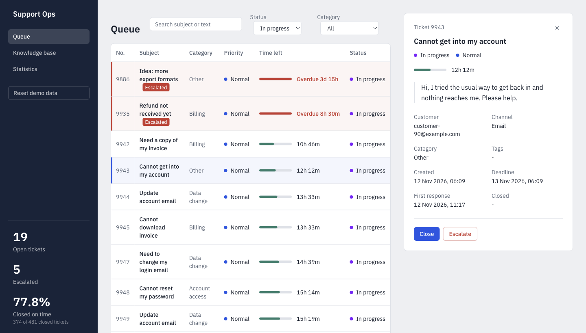
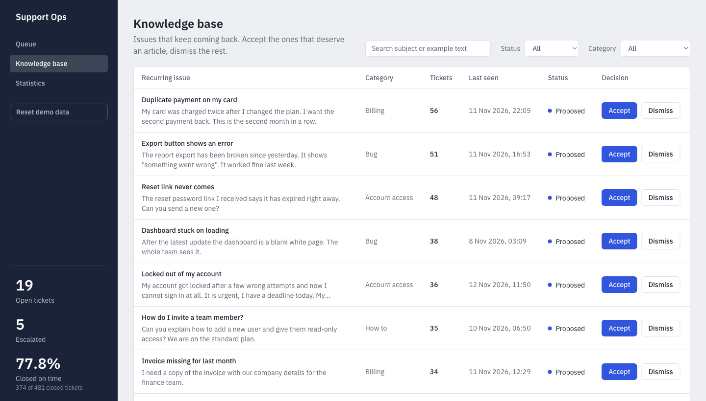
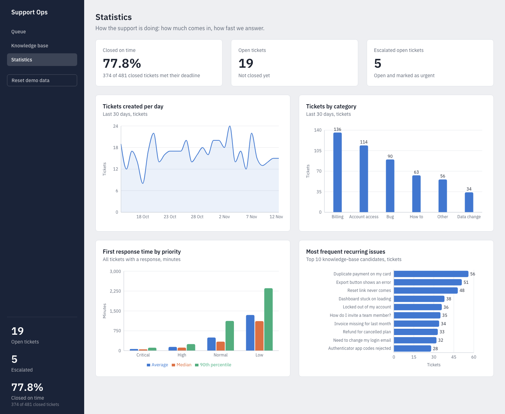
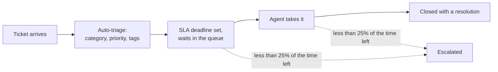
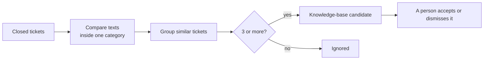

# Support Ops Toolkit

[](https://github.com/madlinTTU/support-ops-toolkit/actions/workflows/ci.yml)

A small, working model of how a support team runs: tickets arrive, get triaged automatically, are tracked against deadlines (SLAs) and escalated before they are missed, and the problems that keep coming back are found and proposed as knowledge-base articles. It has a TypeScript backend with plain SQL on PostgreSQL, a React app for the agent, tests that run against a real database, and a one-command Docker setup.



## Run it in one command

You only need Docker.

```bash
git clone https://github.com/madlinTTU/support-ops-toolkit.git
cd support-ops-toolkit
docker compose up --build
```

Then open **http://localhost:3000**. The first start builds the image (a couple of minutes). It applies the database migrations, creates 500 sample tickets, triages them and finds the recurring issues, so the pages are full at once.

- The API documentation (Swagger) is at http://localhost:3000/api/docs.
- Port 3000 is taken? Use another one: `APP_PORT=3100 docker compose up --build` (on Windows, or to keep the setting, copy `.env.example` to `.env` and change `APP_PORT` there).
- The data survives restarts. To remove it: `docker compose down -v`.
- The **Reset demo data** button in the navigation erases everything and creates a new random set, so the statistics change every time.

## What you can do in the app

**Work the queue.** The queue lists tickets with the most urgent first. A bar shows how much of the SLA time is left: green is fine, amber means less than a quarter is left, red means the deadline has passed. Escalated tickets are highlighted. An agent can open a ticket, **take** it, **close** it with a resolution, or **escalate** it. Search and filters by status and category are on the page.

**Decide what deserves a knowledge-base article.** Problems that keep coming back are grouped, with an example text and the number of tickets. A person accepts or dismisses each one.



**See how support is doing.** Closed-on-time rate, open and escalated tickets, tickets per day, volume by category, first response time by priority and the most frequent recurring issues. The page follows the light or dark theme of the system.



## How it works

### Flow 1: the life of a ticket



**Triage** is a set of plain rules, written as pure functions so they are easy to test:

- Each of the six categories (account access, billing, data change, bug, how-to, other) has a list of keywords. A keyword found in the subject scores 2, in the body 1. The category with the highest score wins; with no match the ticket is "other".
- The priority comes from the words in the text: words like *fraud*, *hacked* or *charged twice* make it **critical**; *urgent*, *locked out* or *cannot sign in* make it **high**; how-to questions are **low**; everything else is **normal**.
- The keywords that matched become the ticket's tags.

**SLA and escalation.** Every priority has a time to solve a ticket: critical 4 hours, high 8, normal 24, low 72. A job inside the app runs every 5 minutes: it triages new tickets, sets their deadlines and escalates open tickets that have less than 25% of their time window left.

*How good is the triage?* On the generated tickets (which come with the correct answers) it picks the right category for about 93-97% of them and the right priority for about 83-85%, measured with four different seeds. The generator deliberately writes some tickets with vague wording, so the result is not 100%. Keep in mind that this is measured on data from the same generator, so real tickets would score lower.

### Flow 2: finding the problems that keep coming back



1. Only closed tickets are used, and tickets from different categories are never compared.
2. The subject and the text of a ticket become a set of words: lower case, at least 3 letters, without common words such as *the* or *please*.
3. Two tickets are compared with the **Jaccard similarity**: the number of shared words divided by the number of all different words in both. For example `{password, reset, email, arriving}` and `{password, reset, link, expired}` share 2 of 6 words, which is 0.33.
4. Tickets with a similarity of at least **0.3** go into one group. A new ticket joins every group where it is similar to at least one member, so groups that turn out to be connected merge.
5. A group of **3 or more** tickets becomes a knowledge-base candidate. The most typical ticket (the one most similar to all the others) gives the subject and the example text. Running it again updates the existing candidates instead of creating duplicates.

*Why 0.3?* With a threshold of 0.5 the same problem written in different words ended up in two or three separate candidates: 33 candidates for about 12 real problems. At 0.3 there are 15, and different problems are still never merged (they start to merge only around 0.2). The numbers come from the generated data, so on real text the threshold would need tuning. A known limit: the method counts shared words and does not know that "charged twice" and "double payment" mean the same.

### The SQL behind the statistics

The five analytics queries are plain SQL, each in its own file, and the API serves them to the statistics page:

| Query | What it uses |
|---|---|
| Closed-on-time rate (overall and per priority) | `count(*) FILTER (WHERE closed_at <= sla_due_at)` |
| Tickets by category, last 30 days, with percentages | a window function, `sum(count(*)) OVER ()` |
| Tickets per day, including days with none | `generate_series` joined with `LEFT JOIN` |
| First response time: average, median, 90th percentile | `percentile_cont(0.5)` and `percentile_cont(0.9)` |
| Top recurring issues | a sorted `LIMIT 10` over the candidates |

Each query is tested against a small data set whose expected numbers are calculated by hand, and also against an empty table.

### The daily report and the generated data

- A report script prints a plain-language report and saves it as a text file: tickets of the last 24 hours, open and escalated tickets, the closed-on-time rate and the top 5 candidates. The "potential tickets avoided" line multiplies their ticket counts by an **assumed 40%** and is labelled *simulated estimate*, with the assumption shown next to it.
- The ticket generator uses a seeded random generator: a dozen recurring problem types written in several ways, plus eight one-off problems. It also simulates agents, so about 80% of the closed tickets meet their deadline and the rest are late. The same seed gives the same tickets, which makes the tests repeatable; the reset button uses a random seed.

## Tech stack

| Part | Technology |
|---|---|
| Backend | Node.js 24, TypeScript, NestJS 12 |
| Database | PostgreSQL 17, plain SQL through `pg` (no ORM), migrations with node-pg-migrate |
| API docs | Swagger (OpenAPI) generated from the code |
| Frontend | React 19, Vite, Tailwind CSS 4, TanStack Query, Recharts, React Router |
| Tests | Vitest, Testcontainers (a real PostgreSQL in Docker), supertest |
| Tooling | oxlint, Prettier, GitHub Actions, Docker Compose |

## API

All endpoints are visible and can be tried in Swagger at `/api/docs`.

| Endpoint | What it does |
|---|---|
| `GET /api/tickets` | List with filters (`status`, `category`, `escalated`) and `search`, most urgent first, with the time left |
| `GET /api/tickets/{id}` | One ticket |
| `POST /api/tickets/{id}/take`, `/close`, `/escalate` | Actions that move a ticket between statuses |
| `GET /api/summary` | Open, escalated and closed-on-time figures |
| `GET /api/stats/...` | One endpoint per analytics query |
| `GET /api/kb-candidates`, `PATCH /api/kb-candidates/{id}` | List with filters and search, accept or dismiss |
| `POST /api/demo/reset` | Replace the data with a new generated set |

A status change that is not allowed (for example closing a ticket that nobody took) returns 409, an unknown id returns 404 and bad input returns 400, all in one format: `{ "type", "message", "code" }`. Taking a ticket checks and changes the status in a single SQL statement, so two agents cannot take the same ticket.

## Tests and CI

There are more than 160 automated tests. The integration tests run the real SQL, the services and the HTTP API against a clean PostgreSQL started in Docker for each test run, and the SQL queries are checked against small data sets with hand-calculated results.

GitHub Actions runs the format check, lint, type check and the tests of both packages, builds the frontend and builds the Docker image on every pull request and on every push to `main` (the badge at the top shows the result). The frontend is covered by TypeScript, lint and the production build, not by automated tests.

## Project structure

```
backend/
  src/
    tickets/          list, take, close, escalate (API and SQL)
    triage/           the rules for category, priority and tags
    sla/              deadlines and the scheduled escalation
    knowledge-base/   recurring-issue detection and the candidates
    analytics/        the SQL queries and the statistics API
    reports/          the daily text report
    demo/             the ticket generator and the data reset
    search/ web/      search patterns, error format, serving the page
  migrations/         plain SQL migrations
  scripts/            seed.ts and report.ts
  tests/              mirrors src/ (unit tests and *.e2e-spec.ts integration tests)
frontend/src/         api/, hooks/, components/, pages/, lib/
assets/screenshots/   the images used in this README
Dockerfile, docker-compose.yml, .github/workflows/ci.yml
```

## Limitations

This is a learning project and a model, not a product.

- **Synthetic data only.** There are no real tickets, and the accuracy figures above are measured on the generator's own labels.
- **Triage is keyword rules, not machine learning.** It does not understand meaning or typos.
- **Similarity counts shared words.** Synonyms can split one problem into two candidates, and the threshold was tuned on generated data.
- **No login and no roles.** The Reset demo data button works for anyone who can reach the app. That is fine on a laptop; protect it before putting the app on a public server.
- **One app instance.** The 5-minute job runs inside the app process; there are no queues or multiple workers.
- **Small scale.** The ticket list has no pagination (a few hundred tickets).
- **No integrations** with real helpdesk tools, and no automated tests for the frontend.

## How this was built

Support operations was a new area for me, and I am not an expert in it. I wanted to understand how a support team really works, and to see how automation and support can be combined: what can be decided by rules (sorting tickets, deadlines, escalation) and what has to stay with a person (solving the case, deciding to write an article).

Java and PostgreSQL are my main stack; Node.js and NestJS were new to me. The code and the tests were written with Anthropic's AI assistant (Claude Code), and I reviewed all the changes.
